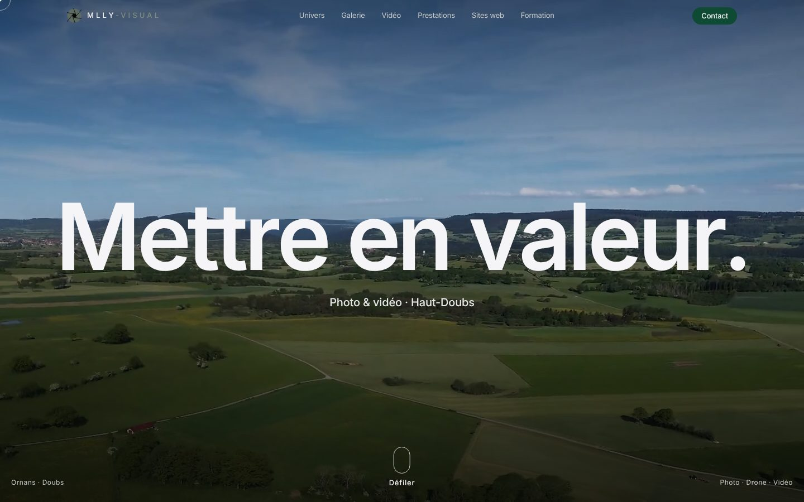
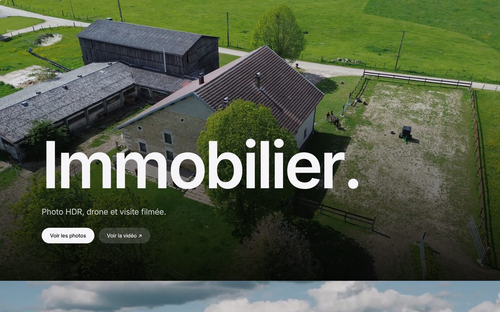
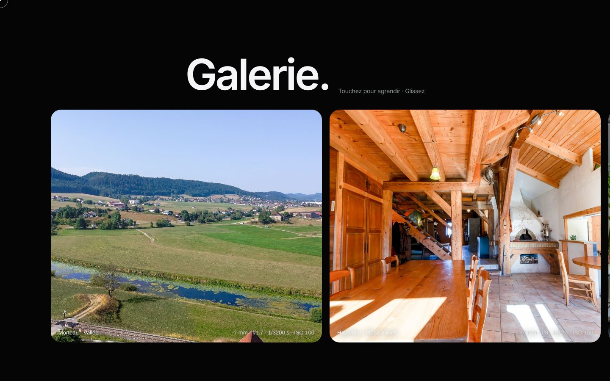
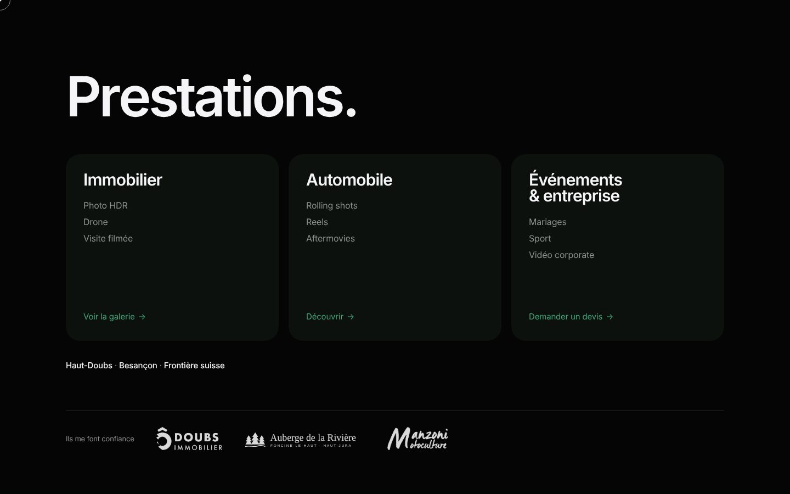
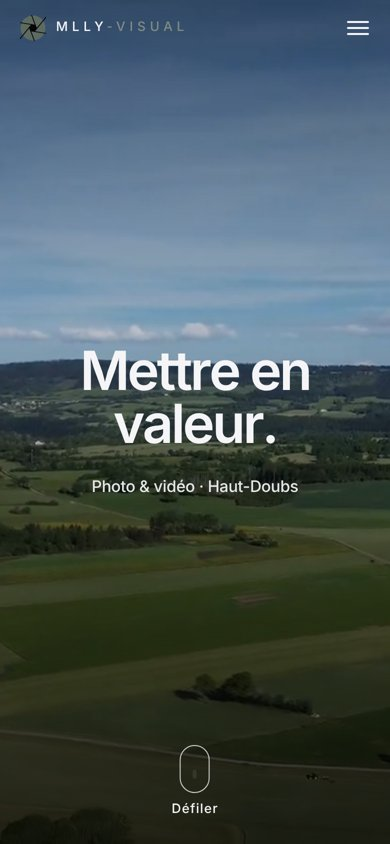

# mlly-visual.fr

**Site de MLLY-VISUAL, photographe et vidéaste immobilier à Ornans (Doubs).**

👉 **En ligne : [mlly-visual.fr](https://mlly-visual.fr)**

C'est le site vitrine de mon activité. J'y présente mes photos HDR, mes prises de vue par drone et mes visites filmées pour les agences immobilières du Haut-Doubs, de Pontarlier à Besançon. On y trouve aussi mon travail en automobile et en événementiel, ma formation photo immo et mes réalisations de sites web.

  
  

  
  

## Ce qu'il y a dedans

- **Une vitrine sur une seule page**, en noir et vert. Elle s'ouvre sur une vidéo plein écran, puis présente mes réalisations en immobilier, en automobile et en événementiel, mes reels et ma galerie. Chaque vidéo existe en deux versions : une pour ordinateur, une plus légère pour mobile.
- **La section « Sites web »**, avec un navigateur animé qui fait défiler mes projets : [Graille 24/24](https://graille.mlly-visual.fr), Manzoni Occasion et l'Auberge de la Rivière.
- **La page Formation**, qui présente mon guide de photo immobilière.
- **Les pages légales** : mentions légales, confidentialité et CGV.

## Contenu de ce dépôt

Ce dépôt contient la partie visible du site : les pages, le design, les animations, les photos et les vidéos. Il est écrit en HTML, CSS et JavaScript, sans framework. La partie serveur n'est pas publiée : paiement, formulaire de contact et espace admin.

## Auteur

**Timothé Mailley** ([MLLY-VISUAL](https://mlly-visual.fr)) : photo, vidéo et sites web dans le Doubs.

© Timothé Mailley. Tous droits réservés. Les photos et vidéos ne sont pas libres de droits.
